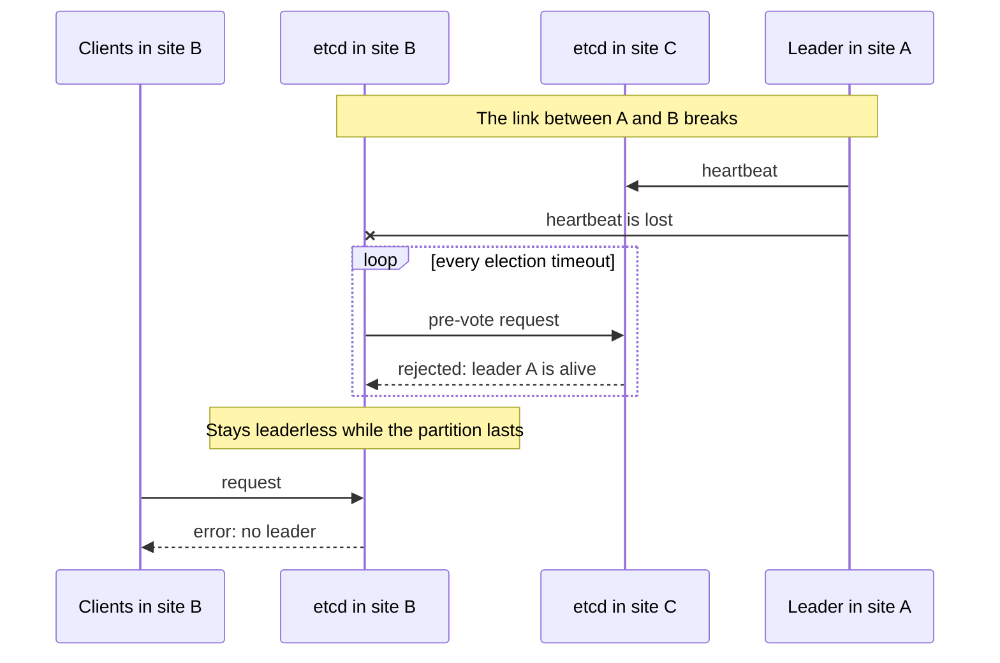

# threek

A drop-in etcd supervisor that keeps the Raft leader on a member every other member can reach.

> **Status:** early development, not usable yet. The supervisor and the decision engine are implemented; the agent does not talk to etcd yet. See [docs/design.md](docs/design.md).

## The problem

Take a three-member etcd cluster across three sites, A, B and C.
The link between A and B breaks, while C still reaches both.

If the leader is in A, etcd never recovers on its own.
The member in B loses the leader and asks for an election, but C refuses to vote because it still hears the leader in A.
This is how PreVote and CheckQuorum are supposed to work: they protect Raft from disruptive elections.
The member in B stays leaderless for as long as the partition lasts, and every client attached to it fails.



The fix is a manual `etcdctl move-leader` to the member in C. threek does it automatically.

## How it works

threek replaces the `etcd` binary in the image.
It starts upstream etcd with the original arguments and runs a small agent next to it, in a separate process.

The agent follows one rule:

> If the leader cannot reach some member, and another member reaches everyone, the leader transfers leadership to that member.

- Reachability comes from etcd itself: the `etcd_network_active_peers` metric of each member, read through the client port that is already open between members.
- Only the leader acts, using the standard `MoveLeader` API. No consensus between agents, no etcd fork, no new ports.
- When nobody reaches everyone (a site is down, the network is fully split), threek does nothing and Raft behaves as usual.
- Optionally, a preferred member holds the leader in normal operation, and the leader returns to it after a partition heals.

Expected reaction time with the defaults is about 25 seconds from the link failure.

## Requirements and limitations

- Exactly three voting members. Learners are ignored.
- The client port (2379) must be reachable between members, not only the peer port (2380): the leader reads the other members' metrics through it.
- Client certificate authentication (mTLS) is supported and expected.
  etcd authentication (`etcdctl auth enable`, `spec.auth` in etcd-operator) is not supported: `MoveLeader` requires the root role.
- Client and peer TLS as configured by Talos or etcd-operator: the agent reuses etcd's own certificates.
- Synchronized clocks on all members, as etcd itself expects.
- Clients must not be routed across the partition. threek restores a leader for every member, but a client in one site that is load-balanced to a member in an unreachable site still fails. Use topology-aware routing (for example `trafficDistribution: PreferSameZone`) or list every member in the client configuration.
- With a preferred leader configured, threek stores small records under the `/threek/members/` prefix of the cluster's own keyspace.

### Talos

- Talos runs `/usr/local/bin/etcd` from the image set in `cluster.etcd.image`, and threek's settings go to `cluster.etcd.extraArgs`.
- With `cluster.etcd.image` set explicitly, Talos upgrades no longer upgrade etcd. Upgrade etcd by changing the threek image.

```yaml
cluster:
  etcd:
    image: ghcr.io/aenix-io/threek:<threek version>-etcd<etcd version>
    extraArgs:
      threek-mode: dry-run
      threek-identity: zone-c          # unique per member
      threek-preferred-leader: zone-c  # optional, same on every member
```

### etcd-operator

threek needs two features in [cozystack/etcd-operator](https://github.com/cozystack/etcd-operator): `spec.extraArgs` and a per-member `THREEK_IDENTITY` environment variable from the downward API.
Extra arguments apply only to new members, so changing the mode means rolling the members.

## Configuration

| Flag | Default | Meaning |
| --- | --- | --- |
| `--threek-mode` | `off` | `off`: plain etcd. `dry-run`: decide and log only. `enforce`: transfer leadership. |
| `--threek-identity` | empty | label of this member, such as a zone or a node name |
| `--threek-preferred-leader` | empty | identity that should hold the leader in normal operation |

Timing flags and the full reference are in [docs/design.md](docs/design.md#configuration).
Every flag can also be set through an environment variable (`--threek-mode` ↔ `THREEK_MODE`). The flag wins.
The supervisor removes `--threek-*` flags and `THREEK_*` variables before starting etcd.

With `--threek-mode=off` the image behaves exactly like upstream etcd, so rolling back is a flag change.

## Development

```bash
make test   # unit and integration tests
make lint   # golangci-lint
make build  # bin/threek
```

## License

Apache License 2.0, see [LICENSE](LICENSE).
