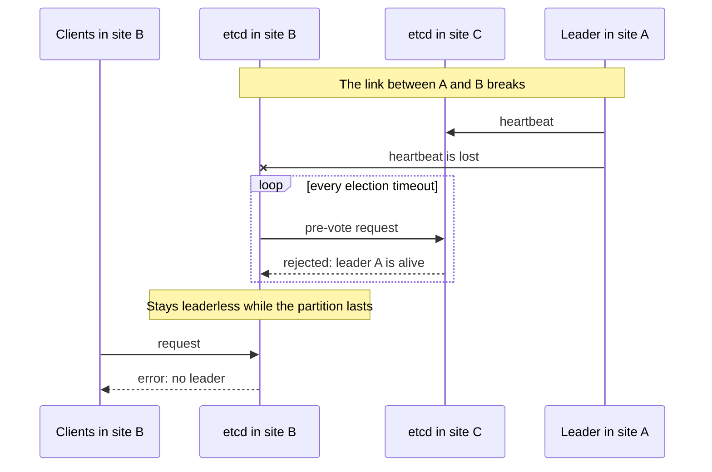

# threek

A drop-in etcd supervisor that keeps the Raft leader on a member every other member can reach.

> **Status:** early development, not released yet. The supervisor, the agent and the container image are implemented and tested end to end against blackhole partitions. See [docs/design.md](docs/design.md).

## The problem

Take a three-member etcd cluster across three sites, A, B and C.
The link between A and B breaks, while C still reaches both.

If the leader is in A, etcd never recovers on its own.
The member in B loses the leader and asks for an election, but C refuses to vote because it still hears the leader in A.
This is how PreVote and CheckQuorum are supposed to work: they protect Raft from disruptive elections.
The member in B stays leaderless for as long as the partition lasts, and every client attached to it fails.



The fix is a manual `etcdctl move-leader` to the member in C. threek does it automatically.

## How it works

threek replaces the `etcd` binary in the image.
It starts upstream etcd with the original arguments and runs a small agent next to it, in a separate process.

The agent follows one rule:

> If the leader cannot reach some member, and another member reaches everyone, the leader transfers leadership to that member.

- Every agent probes its peers with the same request etcd's own prober sends to the peer port, and publishes what it sees in a small record in the cluster itself.
- Only the leader acts, using the standard `MoveLeader` API. No consensus between agents, no etcd fork, no new ports.
- When nobody reaches everyone (a site is down, the network is fully split), threek does nothing and Raft behaves as usual.
- Optionally, a preferred member holds the leader in normal operation, and the leader returns to it after a partition heals.

With the defaults the leader moves about 20 seconds after the link fails.

## Requirements and limitations

- Exactly three voting members. Learners are ignored.
- The client port (2379) must be reachable between members, not only the peer port (2380): the leader checks the other members' status through it.
- Client certificate authentication (mTLS) is supported and expected.
  etcd authentication (`etcdctl auth enable`, `spec.auth` in etcd-operator) is not supported: `MoveLeader` requires the root role.
- Client and peer TLS as configured by Talos or etcd-operator: the agent reuses etcd's own certificates. `--peer-auto-tls` is not supported.
- Synchronized clocks on all members, as etcd itself expects.
- Clients must not be routed across the partition. threek restores a leader for every member, but a client in one site that is load-balanced to a member in an unreachable site still fails. Use topology-aware routing (for example `trafficDistribution: PreferSameZone`) or list every member in the client configuration.
- Each agent keeps one small record under the `/threek/members/` prefix of the cluster's own keyspace. It is rewritten only when what the member sees changes.

### Talos

- Talos runs `/usr/local/bin/etcd` from the image set in `cluster.etcd.image`, and threek's settings go to `cluster.etcd.extraArgs`.
- With `cluster.etcd.image` set explicitly, Talos upgrades no longer upgrade etcd. Upgrade etcd by changing the threek image.

```yaml
cluster:
  etcd:
    image: ghcr.io/aenix-io/threek:<threek version>-etcd<etcd version>
    extraArgs:
      threek-mode: dry-run
      threek-identity: zone-c          # unique per member
      threek-preferred-leader: zone-c  # optional, same on every member
```

### etcd-operator

[cozystack/etcd-operator](https://github.com/cozystack/etcd-operator) selects the image per cluster with `spec.imageRepository` and `spec.imageTagSuffix` and passes threek's flags with `spec.extraArgs`.
Every image is also published under the tag `v<etcd version>-threek.<threek version>`, which is the form the operator builds:

```yaml
apiVersion: etcd-operator.cozystack.io/v1alpha2
kind: EtcdCluster
spec:
  version: "3.6.1"
  imageRepository: ghcr.io/aenix-io/threek
  imageTagSuffix: -threek.0.1.0
  extraArgs:
    threek-mode: dry-run
```

The operator copies these settings onto existing members without restarting them: delete the Pods one at a time to move a cluster onto threek or to change its mode.
This needs an etcd-operator version that supports `spec.extraArgs`, `spec.imageRepository` and `spec.imageTagSuffix`.

## Configuration

| Flag | Default | Meaning |
| --- | --- | --- |
| `--threek-mode` | `off` | `off`: plain etcd. `dry-run`: decide and log only. `enforce`: transfer leadership. |
| `--threek-identity` | empty | label of this member, such as a zone or a node name |
| `--threek-preferred-leader` | empty | identity that should hold the leader in normal operation |
| `--threek-metrics-listen` | empty | address for the agent's Prometheus metrics, such as `127.0.0.1:2390` |

Timing flags and the full reference are in [docs/design.md](docs/design.md#configuration).
Every flag can also be set through an environment variable (`--threek-mode` ↔ `THREEK_MODE`). The flag wins.
The supervisor removes `--threek-*` flags and `THREEK_*` variables before starting etcd.

With `--threek-mode=off` the image behaves exactly like upstream etcd, so rolling back is a flag change.

## Releases

Every release publishes one image per supported etcd version, for `linux/amd64` and `linux/arm64`:

```text
ghcr.io/aenix-io/threek:<threek version>-etcd<etcd version>
ghcr.io/aenix-io/threek:v<etcd version>-threek.<threek version without "v">
```

Both tags point to the same image; the second one is for [etcd-operator](#etcd-operator). Tags are never moved. Images carry provenance and an SBOM, and are signed with cosign keyless signing:

```bash
cosign verify ghcr.io/aenix-io/threek:<threek version>-etcd<etcd version> \
  --certificate-identity-regexp '^https://github.com/aenix-io/threek/' \
  --certificate-oidc-issuer https://token.actions.githubusercontent.com
```

## Development

```bash
make test   # unit and integration tests; set TEST_ETCD_BINARY to an etcd binary to run the tests against real clusters
make lint   # golangci-lint
make build  # bin/threek
make image IMAGE=threek:dev ETCD_VERSION=v3.6.15

# end-to-end tests: containers with blackhole partitions, needs Docker
E2E_IMAGE=threek:dev go test -tags e2e -timeout 20m ./test/e2e/
```

## License

Apache License 2.0, see [LICENSE](LICENSE).
