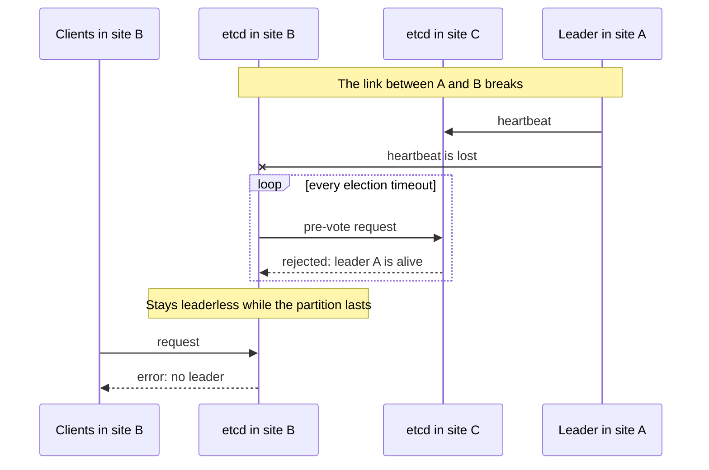

# threek

An agent next to every etcd member that keeps the Raft leader on a member every other member can reach.

> **Status:** early development, not released yet. The agent, the etcd-operator sidecar and the Talos static Pod are implemented. The agent is tested end to end against blackhole partitions next to upstream etcd and inside etcd-operator clusters; the Talos static Pod is not tested on Talos yet. See [docs/design.md](docs/design.md).

## The problem

Take a three-member etcd cluster across three sites, A, B and C.
The link between A and B breaks, while C still reaches both.

If the leader is in A, etcd never recovers on its own.
The member in B loses the leader and asks for an election, but C refuses to vote because it still hears the leader in A.
This is how PreVote and CheckQuorum are supposed to work: they protect Raft from disruptive elections.
The member in B stays leaderless for as long as the partition lasts, and every client attached to it fails.



The fix is a manual `etcdctl move-leader` to the member in C. threek does it automatically.

## How it works

A small agent, `threek-agent`, runs next to every etcd member and talks to etcd only through its public APIs.
etcd itself, its image and its arguments stay as they are. The agent runs in one of two ways:

- **Kubernetes with etcd-operator:** a sidecar container, injected into member Pods by a MutatingAdmissionPolicy.
- **Talos:** a static Pod on every control-plane node, with the etcd client certificate Talos issues to kube-apiserver.

The agent follows one rule:

> If the leader cannot reach some member, and another member reaches everyone, the leader transfers leadership to that member.

- Every agent probes its peers with the same request etcd's own prober sends to the peer port, and publishes what it sees in a small record in the cluster itself.
- Only the leader acts, using the standard `MoveLeader` API. No consensus between agents, no etcd fork, no new ports.
- When nobody reaches everyone (a site is down, the network is fully split), threek does nothing and Raft behaves as usual.
- Optionally, a preferred member holds the leader in normal operation, and the leader returns to it after a partition heals.

With the defaults the leader moves about 20 seconds after the link fails.

## Requirements and limitations

- Exactly three voting members. Learners are ignored.
- The client port (2379) must be reachable between members, not only the peer port (2380): the leader checks the other members' status through it.
- Client certificate authentication (mTLS) is supported and expected.
  etcd authentication (`etcdctl auth enable`, `spec.auth` in etcd-operator) is not supported: `MoveLeader` requires the root role.
- Client and peer TLS as configured by Talos or etcd-operator. `--peer-auto-tls` is not supported.
- Synchronized clocks on all members, as etcd itself expects.
- Clients must not be routed across the partition. threek restores a leader for every member, but a client in one site that is load-balanced to a member in an unreachable site still fails. Use topology-aware routing (for example `trafficDistribution: PreferSameZone`) or list every member in the client configuration.
- Each agent keeps one small record under the `/threek/members/` prefix of the cluster's own keyspace. It is rewritten only when what the member sees changes.

### etcd-operator

- Kubernetes 1.36 or later. On 1.35, enable the `MutatingAdmissionPolicy` feature gate and the `admissionregistration.k8s.io/v1beta1` API, and apply the policy with that API version.
- [cozystack/etcd-operator](https://github.com/cozystack/etcd-operator) needs no changes. The policy relies on its member Pod layout (the `etcd` container, the `tls-client` and `tls-peer` volumes), which is not part of the operator's API.
- The agent reuses the member's certificates: the server certificate must also have the `ClientAuth` extended key usage, and its secret must hold the CA as `ca.crt`. etcd-operator issues it that way.
- The agent is a native sidecar that reserves 100m CPU and 128Mi of memory per member, with limits equal to requests so a Guaranteed member stays Guaranteed. It starts before etcd and counts toward the Pod's readiness. If the agent image cannot be pulled, the member does not start, so mirror the image wherever etcd's own image is mirrored. A crashed agent makes the Pod not ready until it restarts.

Install the policy once per cluster, from the release:

```bash
kubectl apply --filename https://github.com/aenix-io/threek/releases/download/<threek version>/threek-agent.yaml
```

Opt a cluster in with a label. The operator applies it to new Pods only, so roll the members once:

```yaml
apiVersion: etcd-operator.cozystack.io/v1alpha2
kind: EtcdCluster
metadata:
  name: etcd
spec:
  additionalMetadata:
    labels:
      threek.aenix.io/inject: "true"
      # threek.aenix.io/identity: node   # identity from the node name instead of the zone
```

The agent stays off until the ConfigMap `<cluster name>-threek` exists in the cluster's namespace.
Changes reach running agents within a minute or two, without restarting etcd:

```yaml
apiVersion: v1
kind: ConfigMap
metadata:
  name: etcd-threek
data:
  mode: dry-run
  preferred-leader: zone-c   # optional
```

The identity is the node's `topology.kubernetes.io/zone` label, copied to the Pod by Kubernetes, or the node name with `threek.aenix.io/identity: node`.
The agent serves its metrics on port 2390 of the Pod (`threek-metrics`).

### Talos

The agent runs as a static Pod on every control-plane node, from [`deploy/talos-static-pod.yaml`](deploy/talos-static-pod.yaml) or the copy attached to each release.
Talos keeps running etcd from its own image and upgrades it as usual.

- Set `--identity` per node and apply the document as a machine config patch to each control-plane node:

  ```bash
  talosctl --nodes <node> patch machineconfig --patch @talos-static-pod.yaml
  ```

- Every setting is a flag of the agent, such as `--mode=enforce`. Changing one restarts the agent, not etcd.
- The agent uses the etcd client certificate Talos issues to kube-apiserver and picks up a renewed certificate on its next connection. After rotating the etcd CA, restart the agent.

## Configuration

| Setting | Default | Meaning |
| --- | --- | --- |
| `mode` | `off` | `off`: no agent activity. `dry-run`: decide and log only. `enforce`: transfer leadership. |
| `identity` | empty | label of this member, such as a zone or a node name |
| `preferred-leader` | empty | identity that should hold the leader in normal operation |
| `metrics-listen` | empty | address for the agent's Prometheus metrics, such as `127.0.0.1:2390` |

Timing settings and the full reference are in [docs/design.md](docs/design.md#configuration).

- With etcd-operator, `identity` and `metrics-listen` are set by the policy, and every other setting is a key of the ConfigMap.
- On Talos, every setting is a flag of the agent: `--mode`, `--identity`, and so on.

## Releases

Every release publishes the agent image for `linux/amd64` and `linux/arm64`:

```text
ghcr.io/aenix-io/threek-agent:<threek version>
```

The release also carries the manifests with that image pinned by digest: `threek-agent.yaml` for etcd-operator and `talos-static-pod.yaml` for Talos.

Tags are never moved. The image carries provenance and an SBOM, and is signed with cosign keyless signing:

```bash
cosign verify ghcr.io/aenix-io/threek-agent:<threek version> \
  --certificate-identity-regexp '^https://github.com/aenix-io/threek/' \
  --certificate-oidc-issuer https://token.actions.githubusercontent.com
```

## Development

```bash
make test   # unit and integration tests; set TEST_ETCD_BINARY to an etcd binary to run the tests against real clusters
make lint   # golangci-lint
make build  # bin/threek-agent
make image IMAGE=threek-agent:dev

# admission policy tests: a cluster with deploy/threek-agent.yaml applied
POLICY_KUBE_CONTEXT=kind-kind go test -tags policy ./test/policy/

# end-to-end tests: etcd and agent containers with blackhole partitions, needs Docker
E2E_IMAGE=threek-agent:dev ETCD_IMAGE=gcr.io/etcd-development/etcd:v3.6.15 go test -tags e2e -timeout 20m ./test/e2e/

# etcd-operator end-to-end tests on kind
test/kubernetes/setup.sh threek-e2e threek-agent:dev
K8S_E2E_CONTEXT=kind-threek-e2e go test -tags kubernetes -timeout 30m ./test/kubernetes/
```

## License

Apache License 2.0, see [LICENSE](LICENSE).
